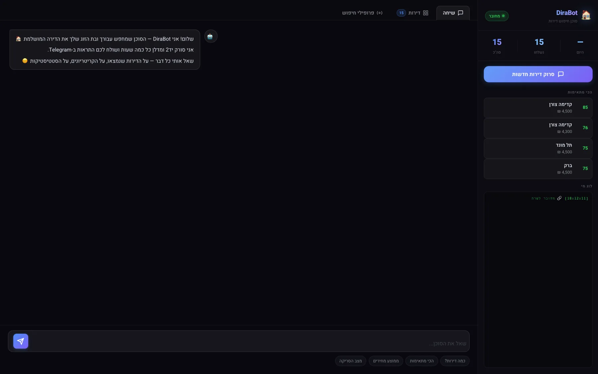

# DiraBot

**Your next apartment finds you.**

An agent that scans Israeli rental listings every few hours, scores each apartment against your criteria and sends only the ones worth seeing to Telegram.



## Highlights

- Stealth Playwright that passes bot protection and reads the site’s internal API
- 0–100 scoring on price, location, rooms, features and keywords, with a notify threshold
- Multiple search profiles, hard filters and junk-listing blocking
- Live dashboard with an agent chat, and duplicate-free alerts

## Tech stack

Python · Playwright · FastAPI · WebSocket · SQLite · Gemini · Telegram Bot

## Run locally

Full Hebrew setup guide (Telegram bot, profiles): [docs/SETUP-he.md](docs/SETUP-he.md)


```bash
python -m venv .venv && source .venv/bin/activate
pip install -r requirements.txt && playwright install chromium
cp .env.example .env && cp config.example.yaml config.yaml
python -m uvicorn server:app --port 6008
```

Dashboard at http://localhost:6008 · see DEPLOY.md for Docker/Railway

> All secrets live in environment variables — see `.env.example`. No keys are committed to this repository.

---

<div dir="rtl">

## בעברית

**הדירה הבאה מגיעה אליך.**

סוכן שסורק מודעות שכירות ביד2 כל כמה שעות, מדרג כל דירה לפי הקריטריונים שלך ושולח לטלגרם רק את מה ששווה לראות.

- Playwright עם stealth שעובר את ההגנות של האתר ומושך נתונים מה-API הפנימי
- ציון 0–100 לפי מחיר, מיקום, חדרים, מאפיינים ומילות מפתח, עם סף התראה
- פרופילי חיפוש מרובים, מסנני חובה וחסימת ״דירות זבל״
- דשבורד חי עם צ׳אט לסוכן, והתראות ללא כפילויות

</div>

---

Part of my portfolio · built by [Ido Rafael](https://github.com/idorl1203-zaid)
